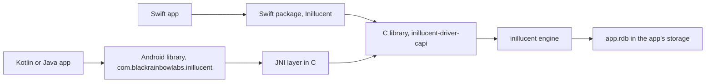

# inillucent on iOS and Android

inillucent runs inside an iPhone, iPad or Android app. The engine runs in the app's own process, and
the database is one `.rdb` file in the app's storage. There is no server and no network connection,
so the tables and the search indexes work offline.

This page is for a programmer who writes an iOS app in Swift or an Android app in Kotlin or Java. It
covers what runs on a phone, how to build the two packages, a first database, search, encryption,
threads and the tests. The full API of each package is in its readme, `packages/swift/README.md` and
`packages/android/README.md` in the repository.

## Terms used on this page

| Term | Meaning |
|---|---|
| C library | `inillucent-driver-capi`, the engine built as a library with a C interface. Both packages call it |
| XCFramework | A folder Xcode reads that holds one library for each Apple platform, with its header |
| AAR | An Android library archive. It holds the Kotlin classes and one native library for each processor family |
| ABI | An Android processor family. The library is built for `arm64-v8a`, `armeabi-v7a` and `x86_64` |
| JNI | The Java Native Interface. It is how Kotlin calls the C library |
| conformance suite | `drivers/conformance/suite.json`, the cases every binding must answer the same way as the engine |

## How an app reaches the engine



The Swift package links the C library as a static library inside an XCFramework, and Swift imports
its header as the module `InillucentFFI`. The Android library links the C library and a small JNI
layer into one `libinillucent_jni.so` for each ABI. Both are the same C library the Python, Node,
Go and PHP packages use, so a statement gives the same answer on a phone as on a laptop.

## What runs on a phone

| Feature | On a phone |
|---|---|
| The SQLite dialect: tables, indexes, joins, views, triggers, window functions, JSON | yes |
| Transactions and the write ahead log, with recovery after a crash | yes |
| Keyword search with FTS5 and `bm25()` | yes |
| `VECTOR(N)` columns, the vector functions and `inillucent_hnsw` indexes | yes |
| Hybrid search with an `inillucent_search` table | yes |
| Encryption at rest with XChaCha20-Poly1305 | yes |
| Stopping a long statement from another thread | yes |
| `embed(TEXT)`, the embedding model inside the engine | no. It needs ONNX Runtime and a model file in the app, and neither package turns it on. `embed()` fails with the status `unsupported` |
| The `inillucent`, `inillucent-shell` and `inillucent-mcp` programs | no. A phone app calls the library. Build the database file on a laptop with the programs if you want to ship one inside the app |

An app that needs search by meaning computes its vectors with a model it already runs, such as a
Core ML model on iOS or a TensorFlow Lite model on Android, and stores them in a `VECTOR(N)`
column. [Search on a phone](#search-on-a-phone) shows how.

## Build the packages

Neither package is on Maven Central or a Swift package index yet. Both build from a checkout of
this repository.

### iOS

You need a Mac with Xcode, and Rust:

```sh
sh packages/swift/build-xcframework.sh
```

The script builds the C library once for each Apple target with
`cargo build -p inillucent-driver-capi --release`, and writes
`packages/swift/InillucentFFI.xcframework` with three slices:

| Slice | Rust targets |
|---|---|
| `ios-arm64` | `aarch64-apple-ios` |
| `ios-arm64_x86_64-simulator` | `aarch64-apple-ios-sim`, `x86_64-apple-ios` |
| `macos-arm64_x86_64` | `aarch64-apple-darwin`, `x86_64-apple-darwin` |

`INILLUCENT_APPLE_PLATFORMS="ios simulator"` builds only the iPhone and simulator slices. Then add
the package to an app with Xcode's "Add Package Dependencies" and its "Add Local" button, or with
`.package(path: "../inillucent/packages/swift")` in another package.

The minimum versions are iOS 13 and macOS 11. The package carries a privacy manifest. It declares no
tracking and no collected data, and it declares the file timestamp API with reason `C617.1`, because
the engine reads the times of its own files with `fstat`.

### Android

You need the Android SDK with NDK 27.1.12297006 and CMake 3.22.1, Java 17 or later, and Rust with
the three Android targets:

```sh
rustup target add aarch64-linux-android armv7-linux-androideabi x86_64-linux-android
sh packages/android/gradlew -p packages/android :inillucent:assembleRelease
```

The AAR is written to `packages/android/inillucent/build/outputs/aar/inillucent-release.aar`.
`-PinillucentAbis=arm64-v8a` builds one ABI. Add the AAR to an app as a file dependency, or include
the project with `includeBuild`.

The minimum Android version is API 24, which is Android 7.0. Every native library is aligned to
16 KB pages, which Google Play requires of an app that targets Android 15.

The size of `libinillucent_jni.so` in the release AAR, before the app's build strips it, was
measured on 2026-10-31 when the packages were added: 12.4 MB for `arm64-v8a`, 9.6 MB for
`armeabi-v7a` and 13.3 MB for `x86_64`.

## A first database

Swift:

```swift
import Inillucent

let folder = try FileManager.default.url(for: .applicationSupportDirectory, in: .userDomainMask, appropriateFor: nil, create: true)
let db = try Database(url: folder.appendingPathComponent("app.rdb"))
let conn = try db.session()
try conn.execute("CREATE TABLE IF NOT EXISTS note (id INTEGER PRIMARY KEY, body TEXT)")
try conn.execute("INSERT INTO note (body) VALUES (?1)", ["hello"])
for row in try conn.query("SELECT id, body FROM note") {
    print(row[0], row[1])
}
```

Kotlin:

```kotlin
import com.blackrainbowlabs.inillucent.Database

Database.open(File(context.filesDir, "app.rdb")).use { db ->
    db.session().use { conn ->
        conn.execute("CREATE TABLE IF NOT EXISTS note (id INTEGER PRIMARY KEY, body TEXT)")
        conn.execute("INSERT INTO note (body) VALUES (?1)", "hello")
        for (row in conn.query("SELECT id, body FROM note")) println("${row[0]}: ${row[1]}")
    }
}
```

Put the file in the app's own storage: Application Support on iOS, `context.filesDir` on Android.
Bind every value with `?1`, `?2` and so on. Values keep their types: NULL, integer, real, text and
blob.

## Search on a phone

An `inillucent_search` table ranks rows by keyword and by vector in one query. In a notes app, each
note's vector comes from the app's own model. The four numbers here stand in for the 384 or more a
real model produces:

```sql
CREATE VIRTUAL TABLE note USING inillucent_search(title, body, dims = 4);

INSERT INTO note (rowid, title, body, vector) VALUES
  (1, 'Camping list',   'Tent, stakes, two sleeping bags and the blue stove.', '[0.9, 0.1, 0, 0.1]'),
  (2, 'Garage shelves', 'The tent stakes are in the red bin on the top shelf.', '[0.8, 0.3, 0.1, 0]'),
  (3, 'Dentist',        'Cleaning on the 14th at 9:30.',                       '[0, 0, 1, 0.2]');

SELECT rowid, title, round(score(note), 3) AS score, origin(note) AS origin
FROM note
WHERE note MATCH 'stakes' AND vector = '[0.8, 0.3, 0.1, 0]' AND k = 3
ORDER BY rank;
```

```
rowid  title           score  origin
-----  --------------  -----  ------
2      Garage shelves  1.0    both
1      Camping list    0.277  both
3      Dentist         0.0    vector
```

That output is what inillucent 2.9.0 printed on 2026-10-31. The phone runs the same engine, so it
returns the same rows. `origin` says whether a row matched the keywords, the vector or both.

From the app, bind the query vector as a parameter. Text in the JSON array form works, and so does a
blob of little endian 32 bit floats:

```swift
let vector = Data(bytes: embedding, count: embedding.count * MemoryLayout<Float>.size)
let hits = try conn.query("SELECT rowid, title FROM note WHERE vector = ?1 AND k = 10", [.blob(vector)])
```

```kotlin
val bytes = ByteBuffer.allocate(embedding.size * 4).order(ByteOrder.LITTLE_ENDIAN)
embedding.forEach { bytes.putFloat(it) }
val hits = conn.query("SELECT rowid, title FROM note WHERE vector = ?1 AND k = 10", listOf(bytes.array()))
```

[Vector search](vector-search.md) covers `VECTOR(N)` columns, HNSW indexes and every option of an
`inillucent_search` table.

## Encryption

```swift
let db = try Database(url: file, key: passphrase)
```

```kotlin
Database.open(file, key = passphrase)
```

The file and its log are encrypted with XChaCha20-Poly1305. A key of the form `x'<64 hex digits>'`
is used as the raw key. Any other key is a passphrase. Opening the file with the wrong key, or with
no key, fails with the status `corrupt`. Keep the key in the Keychain on iOS and in the Android
Keystore on Android. [Encryption at rest](encryption.md) has the details.

## Threads and cancelling

The engine is single threaded for each file. Every `Database` in both packages holds one lock, and
every call on it, on its connections, on its statements and on its transactions takes that lock.
An app can call the library from any thread, and two calls on one database run one after the other.

`Connection.cancel()` does not take the lock. Call it from another thread to stop a long statement.
The statement then fails with the status `interrupted`.

```swift
try conn.transaction { txn in
    try txn.execute("UPDATE account SET balance = balance - 10 WHERE id = 1")
    try txn.execute("UPDATE account SET balance = balance + 10 WHERE id = 2")
}
```

`transaction` commits when the block returns and rolls back when it throws. Kotlin has the same call.

## Errors

Every failure throws one error type: `InillucentError` in Swift, `InillucentException` in Kotlin.
Its status is one of the names the other bindings use, such as `syntax`, `not_found` or
`constraint`. When the engine has not built a construct, the status is `unsupported`, and the error
names the construct. Swift sets `isUnsupported`. Kotlin throws the subclass `UnsupportedException`.
Rewording the SQL does not help with `unsupported`. Use a different construct.

A statement that fails part way through hands back the rows it produced before the failure in
`partialRows`.

## Tests

| Command | Where it runs | What it runs |
|---|---|---|
| `sh packages/android/run-tests.sh` | an Android emulator the script starts, with no window | the conformance suite and the behavior tests, then a check that every native library is aligned to 16 KB |
| `sh packages/swift/run-tests.sh` | a Mac with Xcode: `swift test` on the Mac and `xcodebuild test` on the newest iPhone simulator | the conformance suite and the behavior tests |

The behavior tests cover an encrypted file, a file opened again, a transaction rolled back by a
throw, text with an emoji and a NUL byte, a cancel from another thread, the rows before a failure,
and a close refused while a connection is open. `.github/workflows/mobile.yml` runs both scripts
once a night, Android on Linux and iOS on a macOS runner. Each script prints a line that ends in
`; skipping` and exits 0 on a machine that cannot run it.

A run of `sh packages/android/run-tests.sh` on the Windows development machine on 2026-10-31, on an
Android 16 emulator image, printed:

```
Starting 11 tests on inillucent_test(AVD) - 16
Finished 11 tests on inillucent_test(AVD) - 16
BUILD SUCCESSFUL in 2m 20s
16 KB aligned: 2 libraries
conformance record: _agent_output/conformance/android.json
```

The 11 tests are `ConformanceTest`, which runs all 35 cases of the conformance suite, and the 10
tests in `DatabaseTest`. The record lists all 35 cases under `ran`, including
`fts5_matches_and_ranks`, `a_vector_column_binds_and_reads_back_as_a_blob` and
`hybrid_search_answers_and_ranks`, and none under `failures`.

The iOS job of the `mobile` workflow on 2026-10-31 (run 41246284466, Xcode 26.6, the iOS 26.5
simulator) printed this for `xcodebuild test`:

```
Executed 11 tests, with 0 failures (0 unexpected) in 23.739 (24.419) seconds
** TEST SUCCEEDED **
```

On Windows, Git's `sh` puts its own `/usr/bin/link` ahead of the MSVC linker, and cargo then fails
to link the build scripts it compiles for Windows with `link: extra operand`. Name the MSVC linker
before you run the script:

```sh
export CARGO_TARGET_X86_64_PC_WINDOWS_MSVC_LINKER="C:/Program Files/Microsoft Visual Studio/2022/Community/VC/Tools/MSVC/<version>/bin/Hostx64/x64/link.exe"
sh packages/android/run-tests.sh
```

## Where to go next

- `packages/swift/README.md` and `packages/android/README.md` in the repository have the full API.
- [The drivers page](../drivers/README.md) explains the C library both packages call.
- [Vector search](vector-search.md) covers search in full.
- [Encryption at rest](encryption.md) covers keys and what is encrypted.
