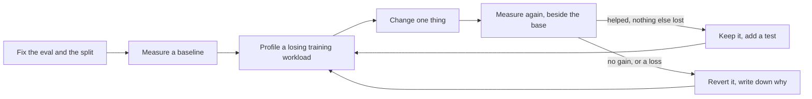

# How inillucent was made faster than SQLite

Lab report, written on 8 October 2026. Published at
[inillucent.com/research/hill-climbing](https://inillucent.com/research/hill-climbing).

**Since this report.** An eighth hill climb ended on 11 October 2026 with release 2.5.4 faster than
SQLite on 110 of the 116 workloads the benchmark times, and 499% faster on the engine plan in a
graded run. [After 8 October](#after-8-october) has what it changed.

On 5 September 2026 inillucent's engine was 432% slower than SQLite 3.53.4 on its own benchmark. On 8
October 2026 release 2.4.2 was 505% faster on the same benchmark, 276% faster through the API a
program calls, and 74% faster when called from the command line, the shell, Python and Node. This
page explains how: the loop we ran, the benchmarks we trusted and why, the changes that moved the
numbers most, the advice we took and the advice we did not, and the mistakes in measurement we found
along the way.

| Engine against SQLite, 5 September | Engine against SQLite, 8 October | Through the `Connection` API, 3 to 8 October | Called the way programs call it, 5 to 8 October |
|---|---|---|---|
| 432% slower | 505% faster | 18% slower to 276% faster | 216% slower to 74% faster |

## Terms used on this page

| Term | Meaning |
|---|---|
| hill climb | a loop of measure, change one thing, measure again, and keep the change only when the numbers say it helped |
| eval | the fixed set of workloads and the scoring rule a hill climb is judged by |
| workload | one timed task, such as reading one row by its key 4,000 times |
| ratio | SQLite's time divided by inillucent's. 2.00x is 100% faster. 0.50x is 100% slower |
| geometric mean | the average of ratios that multiplies them, so one very fast workload cannot carry the result |
| train set, held out set | the workloads a change may be designed from, and the workloads only used to accept or reject it |
| gate | a program that runs the workloads on both engines in the same rounds and grades the result, such as `inillucent-fullgate` |
| the engine plan | the 34 workloads in ten weighted families that the published headline is computed from |
| `Connection` API | `Connection::prepare` and `Statement::step`, the calls every language driver makes |
| A/A run | the same build measured twice, to see how much a number moves when nothing changed |
| quiet check | the gate's test that the machine was idle, by timing SQLite against its own idle speed |

## The short version

| Date | What changed | What it did |
|---|---|---|
| 5 to 6 September | The engine was rewritten: leaf pages store rows column by column, and the executor works on batches of rows | 432% slower to 206% faster |
| 9 September | A write statement stopped rebuilding itself on every execution | 283% to 326% faster; the `transaction` family rose above SQLite |
| 20 September | A commit became one log append and one sync, `count(*)` became one addition per batch, and an index build writes its pages once | 255% to 353% faster |
| 23 September | Both engines were pinned to the same eight fast processor cores | a measurement fix: unpinned runs had put inillucent on the slow cores |
| 26 September | Correlated subqueries stopped growing a 3.2 MB array on every execution | 419% faster in the last graded run |
| 3 to 5 October | Three hill climbs through the `Connection` API, on 48 workloads applications meet | 18% slower to 116% faster on the training set |
| 5 to 6 October | Two hill climbs on how programs call the engine: command line, shell, Python and Node | 216% slower to 64% faster |
| 7 October | A hill climb on common operations, with search | 51.5% faster than release 2.3.4; searches 276% faster |
| 8 October | Release 2.4.2 measured for this report | 505% faster on the engine plan, 276% through the `Connection` API, 74% called by programs |

## What a hill climb is

1. **Fix the eval before the first measurement.** The workloads, the split into training and held
   out workloads, and the rule for keeping a change are written down first and not changed after.
   A workload is held out when the FNV-1a hash of its name is 0 mod 3. 20 of the 48 workloads of the
   hill climb plan are held out.
2. **Measure a baseline**, with SQLite timed in the same rounds.
3. **Profile a training workload that loses.** Held out workloads are never used to design a change.
   `inillucent-hcprobe` times one statement shape at a time, and `inillucent-fullgate --workloads`
   runs only the named workloads.
4. **Change one thing.** Every change is a general mechanism, such as a set lookup, a cached setup or
   a lock that is not needed. None is keyed on a workload's SQL text or its data.
5. **Measure again beside the base.** Builds are run in turn, pass by pass, in one quiet window, so a
   change in the machine's speed moves both builds.
6. **Keep or revert by the written rule.** A change is kept when the workloads it targets are faster
   with their whole 95% interval above 1.00, the training mean does not fall by more than 2.5%, the
   held out mean does not fall by more than 2.5%, processor time and peak memory do not rise by more
   than 10% and 3%, the tests pass, and every answer still agrees with SQLite. A rejected change is
   written down with its numbers so it is not tried again.
7. **Add a test for each kept change** that fails without it.

The first rule we wrote said the training mean and the held out mean must both rise. Two
measurements replaced it. Running the same build twice moved a mean by up to 2.5% and one workload by
up to 7%. And a targeted fix moves only the workloads that reach its code: binary search for long
`IN` lists took `edge.not.in` from 958 ms to 4.44 ms, and it is in no held out workload, so the held
out mean could not rise.

## The evals

| Eval | What it runs | Size |
|---|---|---|
| the engine plan, `inillucent-fullgate` | the engine's `plan`, `prepare` and `pipeline` functions directly, in ten weighted families. The published headline | 34 workloads, 30 weighted |
| the engine plan, `--api connection` | the same workloads through the `Connection` API | 34 workloads |
| the hill climb plan, `--plan hillclimb --api connection` | what applications meet and the engine plan does not: rows written by `INSERT`, tables that churn, queries applications write, edge cases, and checks that every written row is still there | 48 workloads, 28 train and 20 held out |
| the usage benchmark | the command line as one process per command, SQL scripts piped into the shell, the Python driver and the npm package, against the `sqlite3` shell, Python's `sqlite3` module and Node's `node:sqlite` | 25 workloads |
| `inillucent-searchprobe` | 5,000 rows of 384 numbers in an `inillucent_search` table: inserts, keyword, vector and hybrid searches, an insert then a search, the first search after an open | 6 cases |
| `inillucent-hcprobe` | one statement shape through the `Connection`, in nanoseconds a call. Each case differs from the next in one thing | per shape |
| the nightly run | the long test suites, every release target, and the gates on the medium fixture, every night at 02:00 | all of them |

Every gate pairs the two engines round by round. A workload's score in one round is SQLite's time
divided by inillucent's in that round, so a machine that slows down slows both. A workload's result
is the median of its rounds. A set's result is the geometric mean of its workloads. The engine
headline is a weighted geometric mean of the ten families, with the weights fixed in
`compat/perf/contract.toml` before any measurement was taken.

## Making the numbers trustworthy

A speed number is only useful when a reader can believe it. Six rules came out of the climbs.

1. **A time counts only after the answer is checked.** Every workload's answer is hashed and
   compared with SQLite's on every round, and a mismatch fails the run. The first hill climb found
   two wrong answers this way: a reverse ordered `LIMIT 20` after 20,000 batched inserts returned
   rows from the middle, and a prepared `OFFSET (?1 % 250) * 20` returned the first page every time.
2. **Both engines run on the same cores.** The test machine has 8 fast performance cores and 16 slow
   efficiency cores. Unpinned, Windows ran inillucent on the slow cores and SQLite on the fast ones.
   The same build read 4.40x unpinned and 4.97x pinned, and nothing in the output said so. Every gate
   now pins itself and checks the SQLite child's mask before it times anything.
3. **The machine must be quiet.** A busy machine slows SQLite about twice as much as inillucent, so
   it makes inillucent look faster. The gate times SQLite against its own speed on an idle machine
   and grades a run only when SQLite is within 3%. Above that, every verdict reads NOT GRADED.
4. **Measure the noise first.** An A/A run, and rounds that change no code the gate runs, say how
   far a number moves on its own. In the climb of 7 October, two such rounds read 1.003 and 0.999.
5. **Use medians.** One SQLite round sometimes took 20 to 35 times its usual time when its own
   checkpoint landed in it. A mean of rounds moved two unchanged builds by up to 3%. A median did not.
6. **Design from the training set, accept on the held out set.** In every round of the climb of 7
   October that moved the gate, the held out workloads rose with the training workloads. A change
   that helps only the workload it was written for shows up as a held out set that did not move.

| A number that looked like an answer | What it was | The fix |
|---|---|---|
| `scan.aggregate` 2.95 ms on one day and 1.76 ms on another, from the same build | the core type each run happened to use | pin both engines to the performance cores |
| `txn.large` 0.09x, far slower than SQLite | the workload ran over rows that already held the bytes it wrote, so SQLite timed 2,000 updates that changed nothing. It also hid a real defect: an update that changed nothing took the most expensive path | reset the column before the clock starts; skip an update that changes nothing (4,067 ns to 867 ns) |
| `read.join` with an interval of 2.8x to 6.5x | the bootstrap resampled every workload together, so the interval measured the distance between a 21x workload and a 0.86x one | grade a family on one value per round |
| 14 command line workloads that could never reach three times SQLite | starting an empty program from the benchmark takes 13 to 17 ms, and 11 ms of that is Node's hidden console | time an empty program every round and report the time above it |
| merging a leaf below a third full made one workload 2.3 times faster and another 2.4 times slower | a 4 MiB log fold moved from one timed statement to the next | profile each statement on its own |
| a test guard that read anywhere from 1.18 to 59.22 for the same code | a stopwatch on a loaded machine | count log writes, page fetches and compiles instead |

## The engine over time

The engine plan, 100,000 rows, both engines with a 128 MiB cache and `synchronous = FULL`.

| Date | Build | Ratio | Against SQLite |
|---|---|---:|---|
| 5 September | the engine before the rewrite | 0.19x | 432% slower, computed from its ten family ratios |
| 6 September | the rewritten engine | 3.06x | 206% faster |
| 9 September | write statements stop rebuilding | 4.26x | 326% faster |
| 19 September | release 0.1.3 | 4.39x | 339% faster |
| 20 September | `main`, before the commit redesign | 3.55x | 255% faster |
| 20 September | one append and one sync per commit | 4.53x | 353% faster |
| 23 September | both engines on the performance cores | 4.97x | 397% faster |
| 26 September | release 1.0.32, graded | 5.19x | 419% faster |
| 3 October | release 2.1.2 | 5.10x | 410% faster |
| 7 October | release 2.3.0, not graded | 5.84x | 484% faster |
| 8 October | release 2.4.2, not graded | 6.05x | 505% faster |

The engine got slower once. Between release 0.1.3 and the commit redesign, `main` fell from 4.39x to
3.55x, because new durability work made every commit write more. The redesign that followed made a
commit one log append and one sync: 100 autocommit statements had made 202 syncs and written 3,252
KiB of log for 50 KiB of rows, and after it they made 100 log writes and 100 syncs.

## Through the API applications call

The engine headline calls the engine directly, and the path every driver uses was much slower.
`SELECT 1` once cost 132,884 ns outside a transaction against 1,126 ns inside one, because every
statement took and released the file lock. On release 2.1.1, `prepare.trivial` read 0.05x through the
`Connection` API. The hill climbs from 3 October measured
through `Connection::prepare` and `Statement::step` instead.

| Date | Build | Training set, 28 workloads | Held out set, 20 workloads |
|---|---|---|---|
| 3 October | release 2.1.1 | 0.851x, 18% slower | 0.669x, 49% slower |
| 3 October | first climb, release 2.1.2 | 1.302x, 30% faster | 1.147x, 15% faster |
| 4 October | second climb, release 2.1.3 | 1.84x, 84% faster | 1.50x, 50% faster |
| 5 October | third climb, release 2.1.5 | 2.160x, 116% faster | 1.769x, 77% faster |
| 8 October | release 2.4.2 | 3.758x, 276% faster | 3.613x, 261% faster |

Processor time for one round of these 48 workloads went from 3,906 ms against SQLite's 1,820 ms
(115% more than SQLite) on release 2.1.1 to 641 ms against 1,945 ms (67% less) on release 2.4.2. Peak
memory went from 100.96 MiB to 59.78 MiB. Each point is that day's run of 10 rounds.

## Called the way programs call it

On 5 October we asked whether the engine's speed reached a person using it. It did not. Release 2.1.5
was 216% slower than SQLite over 25 workloads, and the npm package was 29,270% slower, because every
call started a new process.

| Date | Round | All 25 | Command line | Shell scripts | Python | Node |
|---|---|---|---|---|---|---|
| 5 October | release 2.1.5 | 216% slower | 20% slower | 218% slower | 173% slower | 29,270% slower |
| 5 October | round 1 | 46% slower | 10% slower | 44% slower | 2% slower | 2,223% slower |
| 5 October | round 2 | 39% faster | 1% slower | 35% faster | 77% faster | 102% faster |
| 6 October | round 3, release 2.2.0 | 46% faster | within 1% | 39% faster | 105% faster | 69% faster |
| 6 October | round 4 | 53% faster | within 1% | 40% faster | 109% faster | 171% faster |
| 6 October | round 5 | 68% faster | 7% faster | 50% faster | 129% faster | 250% faster |
| 6 October | round 6, release 2.3.0 | 64% faster | 3% faster | 46% faster | 136% faster | 207% faster |
| 8 October | release 2.4.2 | 74% faster | 6% faster | 49% faster | 135% faster | 418% faster |

Rounds 5 and 6 were separate runs on a machine with different loads, which is why round 6 reads
lower than round 5. The changes that moved these numbers most:

- **Node reached the engine without a new process.** A lookup by key went from 10.35 ms to 0.076 ms
  through one long running process, then to 0.004 ms once the C library loaded into Node directly.
- **The shell stopped rescanning its input.** It checked for the end of a statement on every line,
  so one `INSERT` of 20,000 rows took 5,348.9 ms. Checking only on a line holding `;` made it 81.8 ms.
- **Python results arrive as Python objects**, and one Python execution is one foreign call. A point
  query from Python went from 17.25 us to 6.25 us, and to 3.3 us once a read kept its lock for the
  next statement.
- **The Windows release is built with profile guided optimisation**, trained on these workloads.
- **The CRC of every page and log record uses the processor's instruction.** A 32 KiB page went from
  3.93 us to 0.64 us.

The command line stays close to SQLite because starting a program costs both engines the same and is
most of a short command. From a terminal an empty program starts in 5.7 ms, and a one row query takes
7.55 ms in inillucent and 7.95 ms in SQLite.

## The climb of 7 October, round by round

The goal was 50% faster than release 2.3.4 on common operations: select, join, group by, insert and
`inillucent_search`. The eval was the 82 gate workloads through the `Connection` API plus the 6
search cases, 88 in all, 56 training and 32 held out. A case's score is its speedup against 2.3.4.

| Round | Change | Training | Held out | All 88 |
|---:|---|---:|---:|---:|
| 0 | release 2.3.4 | 1.000 | 1.000 | 1.000 |
| 1 | the search cache survives writes and commits | 1.004 | 1.127 | 1.047 |
| 2 | an exact search table builds a two link graph | 1.003 | 1.168 | 1.060 |
| 3 | a read after a write keeps the read lease | 1.166 | 1.362 | 1.234 |
| 4 | a search segment is read without copies | 1.170 | 1.371 | 1.239 |
| 5 | no lease thread wake per statement; the lock level without a mutex | 1.188 | 1.387 | 1.257 |
| 6 | an oplock on the log segment, on Windows | 1.401 | 1.621 | 1.478 |
| 7 | a one key `GROUP BY` finds small integer keys by value | 1.407 | 1.664 | 1.495 |
| 8 | a keyword or vector search alone runs in place | 1.432 | 1.682 | 1.519 |
| 9 | the exact vector scan in tasks of 2,048 vectors | 1.436 | 1.699 | 1.527 |
| 10 | aggregates read their arguments a batch at a time | 1.507 | 1.793 | 1.605 |
| 11 | a multi term top N rejects by its first term; `LIKE '%x%'` | 1.516 | 1.780 | 1.607 |
| 12 | an append keeps the largest key hint | 1.520 | 1.788 | 1.612 |
| 13 | a new row's index entries take the new key path | 1.523 | 1.778 | 1.611 |

The goal was met at round 10. Rounds 1 and 2 change no code the gate runs, so they also measured the
noise: the gate alone read 1.003 and 0.999. Rounds 12 and 13 are inside the noise and were kept
because each removes measured work from an insert and has its own test.

Round 6 is the largest single step. After round 3, half of an autocommit point read was one system
call, `GetFileSizeEx`, asking the open log segment its length to learn whether another process had
committed. On Windows the process now holds an opportunistic lock on the segment. While it holds the
lock no other handle to the file exists on the machine, so the length is known from this process's
own writes. Another process's open breaks the lock and waits until this process has stopped trusting
its count. An autocommit point read went from 1.74 to 1.91 us to 0.46 to 0.55 us.

## The largest single changes

| Change | Before | After | Times faster, from the two times |
|---|---|---|---:|
| an `OR` of two indexed columns reads each index | 588 ms | 0.88 ms | 668 |
| binary search for an `IN` list of 8 or more constants | 958 ms | 4.44 ms | 216 |
| Node keeps one session process instead of starting one per call | 10.35 ms | 0.076 ms | 136 |
| a correlated `IN` stops growing a 3.2 MB array per execution | 118.19 ms | 0.92 ms | 128 |
| a search after an insert keeps the loaded index | 51 ms | 0.44 ms | 116 |
| the shell checks for a statement end only on lines with `;` | 5,348.9 ms | 81.8 ms | 65 |
| a statement that reads no table takes no file lock | 23.3 ms | 0.82 ms | 28 |
| `count(*)` adds once per batch | 11.41x | 52.16x | 4.6 |
| a commit is one log append and one sync, autocommit `UPDATE` | 0.13x | 0.94x | 7.2 |
| an autocommit point read with the log oplock | 1.74 us | 0.46 us | 3.8 |

## Asking Fable for advice

Fable is an AI model that is slower and more expensive to run than the one that did the building. We
asked it for design advice where measurement could not answer the question, such as whether a change
to the log is safe beside an older release. Every answer was a written document. Fable measured
nothing and changed no code. The builders measured each claim and kept what held.

| Date | Question | Advice | What happened |
|---|---|---|---|
| 5 October | how to be faster than SQLite on every usage workload | a ranked list of ten changes with arithmetic for each, and two direct answers: keep the logical insert record in the log, and defer everything at open except the file handle, the format check and the meta record | followed in order in round 2: 17 of 25 workloads faster than SQLite, up from 5. A guaranteed gap after compaction made no difference |
| 6 October | the last eight workloads slower than SQLite | twelve ranked changes, two premises of the question corrected, and three decisions only the owner could make: a new log record kind, what the command line's `exec` acknowledges, and a new field in the meta record | the owner approved them. Round 5 made every one of the 25 workloads faster than SQLite. Fable estimated a sync at 1.2 ms, and a trace measured 46 us |
| 7 October | how to stop asking the log its length before every statement | reject the two ideas offered, and hold an opportunistic lock on the log segment instead, with the order of steps that makes it correct | built as round 6 of the climb of 7 October. Fable expected under 1.0 us, and it measured 0.46 to 0.55 us. The full test run found one case the advice had not listed, a segment whose file was deleted and reopened, and it was fixed |
| 7 October | how to reach 1.5 on the gate from 1.415 | four changes ranked by gain and risk, with the arithmetic that 82 workloads need the sum of the logs of their speedups to rise by 4.8 | changes 1 and 2 became rounds 10 and 11. The goal was met at round 10, and change 4 was not needed |

Fable's lists of what not to do were followed, except two that the owner approved after reading the
numbers: the new log record kind and the command line's acknowledgement. A change to the file format,
a log record or what is durable when always went to the owner with the numbers beside it.

## What we tried and did not keep

| Change | Measured | Why it was not kept |
|---|---|---|
| an index nested loop that reads its inner side into a hash table | `app.dashboard` 0.83x to 0.45x | a probe costs about 184 ns, and reading a row into the table costs the same |
| a finishing step for the hash of a `GROUP BY` key | `ai.group.total` 0.91 | the old hash kept keys inserted in order close together, and the cache liked that |
| `x % k` by a reciprocal multiply | no change | the cost per row is the calls through the expression tree, not the division |
| 8 KiB pages | the same time as 32 KiB | |
| a larger free list for the library's allocator | 10,000 Python inserts 13.7 ms to 16.1 to 17.5 ms | a block taken from a long free list is a cold cache line |
| a memory mapped read of the data file | 532 us against 473 us for 64 pages | |
| SHARED on the RESERVED byte during a read lease | not built | a writer would wait for a busy reader, and readers do not hold writers up |
| applying a transaction's index entries in key order at commit | not built | every reader of the index inside the transaction would have to see the pending entries. A change of its own |

## Where it stands on 8 October 2026

Release 2.4.2 on the engine plan, the median of three runs of 30 rounds. Not graded: SQLite ran 4.0%
to 4.4% slower than its idle reference, which makes these figures read somewhat high.

| Family | Weight | Ratio | Against SQLite | Bar |
|---|---:|---:|---|---|
| `read.point` | 16% | 34.19x | 3,319% faster | met |
| `large.values` | 4% | 12.34x | 1,134% faster | met |
| `read.analytical` | 10% | 11.25x | 1,025% faster | met |
| `read.range` | 12% | 7.68x | 668% faster | met |
| `read.join` | 8% | 5.22x | 422% faster | met |
| `write` | 20% | 4.44x | 344% faster | met |
| `transaction` | 10% | 2.41x | 141% faster | met |
| `extension` | 8% | 2.27x | 127% faster | met |
| `open.prepare` | 8% | 1.98x | 98% faster | missed: the bar is 5.00x |
| `schema` | 4% | 1.05x | 5% faster | missed: the bar is 3.00x |

Processor time is 73% less than SQLite's and peak memory 14% more. Memory is the one measure where
SQLite is better. Most of the difference is what a Rust process on this machine holds before the
engine starts. One workload of the engine plan is slower than SQLite: compiling `SELECT 1` on every
call, 75% slower. Through the `Connection` API, which keeps the compiled plan, it is 76% faster.

One regression is open. `edge.delete.range`, a `DELETE` of 40,000 rows by a range of rowids, was 4%
faster than SQLite after the third climb and is 233% slower in 2.4.2. It slowed down in a release
between 2.1.5 and 2.3.4, and the climb of 7 October, which measured against 2.3.4, could not see it.
It is filed as a known bug.

[Performance](../performance.md) has every current figure and
[Performance history](../performance-history.md) every earlier one.

## After 8 October

The eighth climb set itself a harder goal than a weighted mean: every one of the 116 workloads, in
all three measurements, at least as fast as SQLite. It started from 74 of 116, because release 2.5.2
had added three questions to the file system per statement that cost about 20 us each on Windows. It
ended at 110 of 116:

| Measurement | Release 2.5.2 | Release 2.5.4 |
|---|---:|---:|
| the engine plan through the engine API | 31 of 34 | 31 of 34 |
| the engine plan through the `Connection` API | 17 of 34 | 32 of 34 |
| 48 common and edge case workloads through the `Connection` API | 26 of 48 | 47 of 48 |

The changes: the file system questions are skipped while the log's oplock shows no other process
has opened it; a range delete unlinks the leaves it empties; a join with a large outer side walks the
inner index once; an update keeps one copy of each leaf as its undo record; an `INSERT ... SELECT`
into an empty table collects its rows in a few large buffers; and a `WHERE` of integer comparisons
is tested a batch of rows at a time. One change was to the benchmark: its `Connection` arm compiled
a statement inside the clock where SQLite's arm compiles before it, and now compiles first.

Two workloads are clearly slower. A range `DELETE` pays for folding the log into the database file,
which lands on it in the plan's fixed order. `SELECT 1` compiled from text on every call through the
engine's own API costs more than SQLite's compile; through the `Connection` API it is faster. The
other four are within 6% of SQLite. [Performance](../performance.md#the-workloads-that-are-slower)
says why for each, and `tasks/task-2226-performance-hillclimb-8.md` has every figure.

## What we learned

- Fix the eval before the first measurement. A weighting or a threshold chosen after the results are
  in chooses the answer.
- Check the answer before trusting the time.
- Measure the noise before judging a change, and use medians when one sample can be 20 times the
  others.
- Run both engines on the same cores on a quiet machine, and say in the output when it was not quiet.
- When a timing will not hold still, count something that does: compactions, log writes, page
  fetches, compiles.
- Profile before changing, and profile each statement on its own.
- Measure the way people use the product as well as the engine. The engine was 419% faster while a
  person calling it from Node waited 29,270% longer than with SQLite.
- Report a floor no program can go under as a floor. 14 command line workloads cannot be three times
  as fast as SQLite, because starting an empty program takes longer than that.
- Ask a stronger model for design advice, and measure what it says. Its estimates were wrong twice
  and its designs held every time they were built.
- Write down every rejected change with its numbers, so nobody tries it again.

## Limits of this report

- Every figure is from one Windows 11 machine with an Intel Core Ultra 9 285. A Linux run on 23
  September measured 53% faster where Windows measured 279% on the same build, and has not been
  repeated since.
- The newest engine runs were not graded, because the machine was not quiet enough.
- The 5 September figure is computed from that day's ten family ratios and weights. No run printed
  it.
- The hill climb workloads were written by the people improving the engine. The held out set guards
  against tuning to them, and the engine plan's weights were fixed before any measurement.
