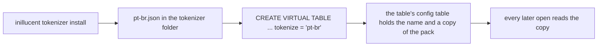

# Tokenizer packs

An `inillucent_search` table turns text into terms with a tokenizer. The built in tokenizer,
`porter`, is English. A tokenizer pack is a small JSON file that says how another language's words
become terms. This page is the reference for the pack file, how a table finds its pack and keeps a
copy of it, and what each refusal means.

## Terms used on this page

| Term | Meaning |
|---|---|
| **tokenizer** | the code that splits text into words and turns each word into a term |
| **term** | what a word becomes after the tokenizer has cleaned it up. The index stores terms, and a query is turned into terms the same way |
| **stemmer** | the step that cuts a word down to its stem, so `reembolsos` and `reembolso` both become `reembols` |
| **stopword** | a word so common that the tokenizer drops it, such as `de` or `the` |
| **accent folding** | replacing a letter that carries an accent with the plain letter, so `notificação` and `notificacao` can meet |
| **tokenizer pack** | a JSON file that names a stemmer, a stopword list, whether accents are folded, and suffix rules |

## Use a pack

```sh
inillucent tokenizer install --file examples/tokenizers/pt-br.json
inillucent create app.rdb
inillucent --db app.rdb exec "CREATE VIRTUAL TABLE docs USING inillucent_search(body, tokenize = 'pt-br')"
inillucent --db app.rdb exec "INSERT INTO docs(rowid, body) VALUES (1, 'Política de reembolso'), (2, 'Notificação enviada'), (3, 'Horário de atendimento')"
inillucent --db app.rdb query "SELECT rowid, body FROM docs WHERE docs MATCH 'notificacoes'"
```

```text
rowid  body
-----  -------------------
2      Notificação enviada
```

The query has no accents and is plural. The row has accents and is singular. Both become the term
`notific`, so the row is found. The same row in a table with no `tokenize` option is not found,
because `porter` does not fold accents and does not know Portuguese plurals.

`examples/tokenizers/pt-br.json` is the Brazilian Portuguese pack the repository ships. Its readme,
`examples/tokenizers/README.md`, says how it was made and how well it matches PostgreSQL.

`inillucent tokenizer list` shows `porter` and every installed pack.
`inillucent tokenizer remove --name pt-br` deletes an installed pack. Each command takes
`--output json`.

## How a table finds its pack and keeps it



1. `CREATE` looks for `<name>.json` in the tokenizer folder. The folder is the one
   `INILLUCENT_TOKENIZER_DIR` names when that variable is set, and only that folder. Otherwise it
   is the `tokenizers` folder in the install root, which is `INILLUCENT_HOME` or the per user
   folder `inillucent setup-embeddings` uses.
2. The table writes two rows into its `<table>_config` table: `tokenize`, which holds the name,
   and `tokenizer_pack`, which holds the whole pack as JSON.
3. Every later search, write and integrity check reads the pack from `<table>_config`. The folder
   is not read again.

So removing or changing an installed pack never changes a table that already exists, and a
database copied to another machine opens there without the pack. A table cannot change its
tokenizer after it is created. To change it, create a new table and copy the rows into it.

A table with no `tokenize` option, or with `tokenize = 'porter'`, writes `tokenize = porter` and no
`tokenizer_pack` row. Its terms are the same terms the engine produced before tokenizer packs
existed.

## The file

```json
{
  "format": 1,
  "name": "pt-br",
  "description": "Brazilian Portuguese",
  "stemmer": "portuguese",
  "fold": true,
  "stopwords": ["de", "a", "o", "que", "e", "não"],
  "suffixes": [
    { "ending": "coes", "becomes": "ções" },
    { "ending": "cao", "becomes": "ção" }
  ]
}
```

| Field | Rule | Default |
|---|---|---|
| `format` | must be `1` | required |
| `name` | 1 to 32 characters. The first is a lowercase letter or a digit, the rest are lowercase letters, digits, `-` and `_`. It may not be `porter` | required |
| `description` | at most 200 characters | empty |
| `stemmer` | `none`, or one of `arabic`, `danish`, `dutch`, `english`, `finnish`, `french`, `german`, `greek`, `hungarian`, `italian`, `norwegian`, `portuguese`, `romanian`, `russian`, `spanish`, `swedish`, `tamil`, `turkish` | required |
| `fold` | `true` folds accents before and after the stemmer | `false` |
| `stopwords` | at most 10,000 words. Each is lowercase letters and digits only, at most 64 bytes | none |
| `suffixes` | at most 256 rules. `ending` is lowercase letters and digits, with no accent when `fold` is `true`, and no two rules have the same `ending`. `becomes` is lowercase letters and digits, or empty | none |

A field that is not in this table is refused, so a misspelled `stopword` is an error and not a
pack with no stopwords. A file over 1 MiB is refused before it is read. The stemmers are the
Snowball algorithms in the `rust-stemmers` crate.

A pack with `"stemmer": "none"`, `"fold": true` and no stopwords lowercases and folds and does
nothing else.

## What a pack does to one word

The engine splits the text and passes each lowercase run of letters and digits through six steps.

| Step | What happens | `Notificações` under `pt-br` |
|---|---|---|
| 1 | when `fold` is `true`, fold the accents | `notificacoes` |
| 2 | when the word is a stopword, it produces no term. Stopwords are folded when the pack is read, so `não` and `nao` are the same stopword | `notificacoes` |
| 3 | when the word is longer than 64 bytes, it produces no term | `notificacoes` |
| 4 | when the word ends with a rule's `ending` and is longer than it, replace the ending with `becomes`. The longest ending wins | `notificações` |
| 5 | stem with the pack's stemmer | `notific` |
| 6 | when `fold` is `true`, fold the stem | `notific` |

Some things happen before these steps and are the same for every tokenizer. A compound identifier
such as `SC-1522` or `parse_headers`, and an email address such as `ana.souza@exemplo.com.br`, are
also stored whole, lowercased and never stemmed or folded. A pack cannot change that.

**Accents are folded on both sides of the stemmer** because the Snowball Portuguese stemmer reads
accents in its suffixes. Folding first turns `notificações` into `notificacoes`, which the stemmer
reads as a different word. The suffix rules in step 4 put the accent back on the ending, the
stemmer then sees the spelling it expects, and step 6 folds what is left.

The fold table covers the lowercase Latin letters from U+00E0 to U+017F, and the Romanian `ș` and
`ț`. Each letter becomes one plain letter: `ç` becomes `c`, `ø` becomes `o`, `ł`
becomes `l`. A letter of its own is left as it is: `ß`, `æ`, `œ`, `ð`, `þ` and `ı`.

## Errors

| When | Status | Exit code | Message |
|---|---|---|---|
| `tokenize = '../x'`, or any name that breaks the naming rule | `syntax` | 1 | `inillucent_search: a tokenizer name is lowercase letters, digits, - and _, not ../x` |
| the pack is not installed | `invalid_state` | 1 | `inillucent_search: no tokenizer named klingon is installed. This build has porter. Installed packs: pt-br. Run inillucent tokenizer install --file <pack>.json to add one` |
| the installed file is not a valid pack | `syntax` | 1 | `inillucent_search: the tokenizer pack klingon does not read: ...` |
| a table's stored pack is in a later format | `unsupported` | 3 | `inillucent_search: this table's tokenizer pack is in format 2, and this build reads format 1` |
| a table's stored name and its declared name differ, or its stored pack is missing | `syntax` | 1 | `inillucent_search: the terms were produced by porter, but the table declares pt-br` |

`invalid_state` means the statement is right and the machine is missing something: install the
pack and run the same statement again. A table whose stored tokenizer cannot be read refuses a
search and still answers a plain `SELECT`, so its rows can be read and copied out.

`inillucent tokenizer install` and `remove` are refused under `--root`, because the tokenizer
folder is outside the root, and under `--readonly`. `list` always answers.

## Older releases

A release from before tokenizer packs cannot open a database that holds a table with a pack. It
reads `tokenize = 'pt-br'` from the table's `CREATE` statement, does not know the name, and the open
fails with `SQL logic error`. Measured with release 2.4.2 on a database this build wrote. A
database whose search tables all use `porter` opens in both.

## Where to go next

- [Vector search](vector-search.md) lists every option of an `inillucent_search` table.
- [Search explained from the start](search-explained.md) shows what a tokenizer does, step by step.
- [How the retrieval engine works](architecture.md) has the BM25 scoring that reads the terms.
